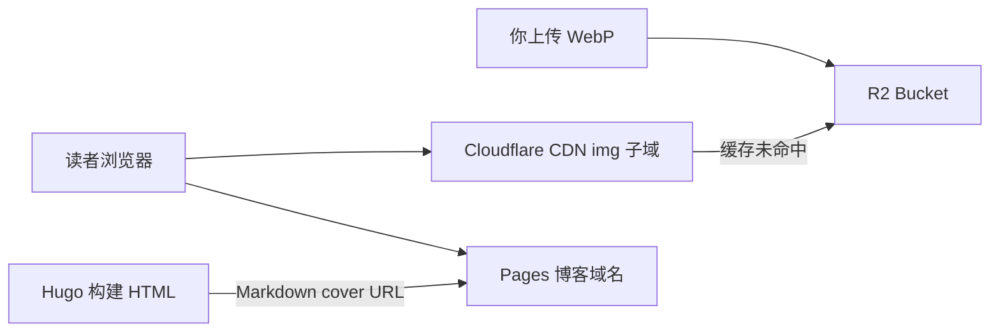

# Cloudflare R2 图床 + CDN（完整实施指南）

下文用 **`example.com`** / **`img.example.com`** 代表你的域名，请替换成真实域名。  
博客 Pages 项目：**`vvcat-blog`**（主域 https://vvcat.space/，备用 https://dongli-blog.pages.dev/）。

---

## 目标与架构

| 项 | 选择 |
|----|------|
| 对象存储 | Cloudflare **R2**（免费档：约 10GB 存储 + 高额读写；**出站 $0**） |
| CDN | 与博客同账号：**`img.example.com`** 橙云代理 + Cache Rules |
| 博客 | Pages 不变；文章/封面用 **HTTPS 绝对 URL** 指向 R2 |



**与 Spectra 的关系**：外链图 **不会**经过 Hugo 构建期的 `imageOptimize`/WebP 管道；上传前请在本地压成 **WebP/JPEG**（见阶段 5）。

---

## 阶段 0：前提检查

- [ ] 域名已在 **Cloudflare** 托管且状态 **Active**（若未完成，先按 [spaceship-cloudflare-custom-domain.md](spaceship-cloudflare-custom-domain.md) 做 NS）
- [ ] 博客主域可访问（`example.com` 或 `dongli-blog.pages.dev`）
- [ ] 本机可登录 Cloudflare Dashboard；可选安装 [Wrangler](https://developers.cloudflare.com/workers/wrangler/) 或 [rclone](https://rclone.org/) 便于批量上传

---

## 阶段 1：创建 R2 存储桶

1. Dashboard → **R2 Object Storage** → **Create bucket**。
2. 建议配置：
   - **Bucket name**：`dongli-blog-resources`（全局唯一，小写连字符）
   - **Location**：Automatic（或选离读者近的 **APAC** 若可选）
3. 先 **不要**公开整个桶到公网裸链；下一阶段用 **自定义域名** 暴露（可缓存、可 HTTPS）。

**命名规范（全站统一）**

```text
posts/{yyyy}/{slug}/cover.webp
posts/{yyyy}/{slug}/{name}.webp
site/avatar.webp
site/banner.webp
```

对象 key **只用小写、数字、连字符**，避免空格与中文路径（URL 编码虽可行但不利于维护）。

---

## 阶段 2：绑定自定义域名（CDN 核心）

### 2.1 在 R2 桶上连接域名

1. 进入桶 **dongli-blog-resources** → **Settings** → **Custom Domains**（或 **Public access** 区域的 *Connect domain*，以当前控制台文案为准）。
2. 添加：**`img.example.com`**（专用子域，勿与 `www` 混用）。
3. Cloudflare 会提示在 **DNS** 自动添加记录；确认 **Proxied（橙色云）** 已开启。

### 2.2 核对 DNS

**Websites** → `example.com` → **DNS** → **Records**：

| 类型 | 名称 | 目标 | 代理 |
|------|------|------|------|
| 通常为 CNAME | `img` | R2 提示的目标 | 已代理 |

### 2.3 SSL

等待 **SSL/TLS** 对 `img.example.com` 为 **Active**（与 Pages 绑域类似，数分钟～数十分钟）。

### 2.4 访问验证

上传一张测试图 `site/test.webp` 后浏览器打开：

`https://img.example.com/site/test.webp`

应返回 200 且证书有效。**生产环境不要依赖** `*.r2.dev` 公共 URL 作为主链。

---

## 阶段 3：缓存加速（Cache Rules）

分步说明见 **[cloudflare-cache-rules-img-cdn.md](cloudflare-cache-rules-img-cdn.md)**。

在 **Websites** → `example.com` → **Rules** → **Cache Rules**（或 **Configuration** → **Cache**）：

**规则示例（静态图长期缓存）**

- **When**：Hostname equals `img.example.com` **且** URI Path 匹配 `*.webp` / `*.jpg` / `*.png` / `*.avif`
- **Then**：
  - Cache eligibility: **Eligible for cache**
  - Edge TTL: **Ignore cache-control and use** 例如 **1 month** 或 **1 year**（图不变可更长）
  - （可选）Browser TTL: 1 day～1 week

**上传时带上 Cache-Control（推荐）**

通过 Wrangler / S3 API 上传时设置元数据：

```http
Cache-Control: public, max-age=31536000, immutable
```

与 Cache Rule 叠加后，边缘命中率更高，R2 读次数更低。

---

## 阶段 4：权限与安全（推荐最小集）

| 策略 | 说明 |
|------|------|
| 桶默认私有 + 仅自定义域公开读 | 使用 R2「Custom Domain」公开读能力，不开放任意 List |
| 不用长期 Access Key 写在 Git | API Token 仅存本机环境变量或 GitHub **Secrets**（若 CI 上传） |
| 防盗链（可选） | 后续可加 **Worker** 校验 `Referer` 为 `example.com`；个人博客可二期再做 |
| CORS | 若仅 `` 引用，一般 **不必** 开 CORS；若前端 JS 读像素再配 |

---

## 阶段 5：上传流程（三选一，可并存）

### 5.1 控制台（偶尔一张）

R2 → 桶 → **Upload** → 按目录结构拖入文件。

### 5.2 Wrangler（与 Pages 同生态）

仓库已配置 [`wrangler.toml`](../wrangler.toml)（桶名 `dongli-blog-resources`）。推荐用脚本：

```powershell
npx wrangler login
.\scripts\upload-image.ps1 -LocalPath .\cover.webp -ObjectKey posts/2026/welcome/cover.webp
```

或手动上传：

```powershell
npx wrangler r2 object put dongli-blog-resources/posts/2026/welcome/cover.webp --file=.\cover.webp --content-type=image/webp --cache-control="public, max-age=31536000, immutable"
```

绑定自定义域：

```powershell
.\scripts\r2-connect-custom-domain.ps1 -ZoneId <你的_zone_id> -Domain img.example.com
```

上传前本地压图：可用 [Squoosh CLI](https://github.com/GoogleChromeLabs/squoosh)、ImageMagick（`magick`）或导出 WebP quality 80–85。

### 5.3 rclone（批量相册）

1. `rclone config` 新建 **Cloudflare R2**（Account ID、Access Key ID、Secret 在 R2 **Manage R2 API Tokens** 创建）。
2. 同步本地目录：

```bash
rclone copy ./album dongli-blog-resources:posts/2026/my-trip --s3-upload-concurrency 4
```

**密钥保管**：`.env` / 密码管理器；**勿提交**到 Git 仓库。

---

## 阶段 6：Hugo / Spectra 内容集成

### 6.1 文章封面（Front Matter）

```yaml
---
title: "标题"
date: 2026-10-11
cover: "https://img.example.com/posts/2026/my-post/cover.webp"
description: "摘要"
---
```

Spectra 对 `cover` 会走 Hugo `resources.Get`，**请使用 Page Bundle 相对路径**（如 `cover.webp`）或站点内路径。R2/CDN 上的图在正文中用 **Markdown 绝对 URL** 引用（见 6.2）。若需卡片缩略图来自 R2，可后续用主题 partial 扩展或保留一张小封面在仓库内。

### 6.2 文内 Markdown

```markdown

```

### 6.3 站点级 avatar / banner（可选）

在 [`hugo.toml`](../hugo.toml) 对应语言 `params` 中：

```toml
# avatar = 'https://img.example.com/site/avatar.webp'
# banner = 'https://img.example.com/site/banner.webp'
```

### 6.4 构建与 baseURL

- 博客 HTML 仍在 Pages 构建；**图片请求浏览器直连 `img.example.com`**，不占 Pages 带宽。
- 保持生产构建 `--baseURL "https://example.com/"`（与主域一致）；与图床子域无关。

### 6.5 外链图 Markdown 钩子

站点已覆盖 [`layouts/_default/_markup/render-image.html`](../layouts/_default/_markup/render-image.html)：以 `http(s)://` 开头的图片 **不再** 走 `resources.Get`，可直接写 R2/CDN 绝对 URL。

### 6.6 不在 Git 里放大图

- **新图默认只进 R2**，仓库只留 Markdown。
- 若曾把图放在 `static/` 且已推送，可逐步迁到 R2 后删仓库内副本以瘦身。

---

## 阶段 7：仓库内可选补充

| 文件 | 内容 |
|------|------|
| [`.agent/AGENT.MD`](../.agent/AGENT.MD) | 记录 `IMG_CDN_BASE=https://img.example.com`、桶名；勿提交密钥 |
| `scripts/upload-image.ps1`（可选） | 封装压图 + `wrangler r2 object put` + 打印最终 URL |

个人博客通常 **不必** 用 GitHub Actions 自动上传图片；本机 Wrangler / rclone 即可。

---

## 阶段 8：验收清单

- [ ] `https://img.example.com/site/test.webp` HTTPS 正常
- [ ] 响应头含 CDN 命中迹象（如 `cf-cache-status: HIT` 二次访问）
- [ ] 一篇测试文章 `cover` 与文内图均显示正常（简中 + 英文各测一次）
- [ ] 手机/桌面、暗色模式下图不裂
- [ ] Cloudflare **R2** 仪表盘：存储量、Class A/B 操作在免费档预期内
- [ ] 仓库无 `*.env`、无 R2 Secret 提交记录

---

## 成本与监控

| 资源 | 个人博客预期 |
|------|----------------|
| R2 存储 | 图 < 10GB → **$0** |
| R2 操作 | 月访问几万次内通常 **$0** |
| CDN | 含在 Cloudflare 免费计划；R2 **无 egress 费** |
| 超额 | Dashboard → **Billing** / R2 用量告警（可设邮件通知） |

定价以 [Cloudflare R2 官方说明](https://developers.cloudflare.com/r2/pricing/) 为准。

---

## 实施顺序（checklist）

1. 确认域名在 Cloudflare **Active**
2. 创建桶 `dongli-blog-resources`
3. 绑定 **`img.example.com`** + SSL Active
4. 配置 **Cache Rules** + 上传时 `Cache-Control`
5. 上传测试图并验证 URL
6. 改一篇 [`content/posts/`](../content/posts/) 文章使用 R2 URL
7. `hugo server` 本地预览 → push → Pages 部署

---

## 风险与规避

| 风险 | 规避 |
|------|------|
| 删桶/删对象导致文章裂图 | 对象 key 带日期；重要图本地备份一份 |
| 外链图无法 Hugo 自动 WebP | 上传前统一 WebP；封面 width 建议 1200–1600px |
| API Token 泄露 | 仅本机/Secrets；轮换 Token |
| 子域未代理 | DNS 必须为橙云，否则无 CDN |
