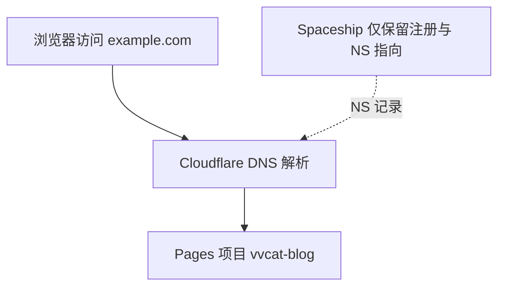

# Spaceship 域名绑定 Cloudflare Pages（详细教程）

下文用 **`example.com`** 代表你买的域名，请全部替换成自己的域名。  
本博客 Pages 项目名：**`vvcat-blog`**，默认 `*.pages.dev` 地址：https://dongli-blog.pages.dev/（改名后子域可能不变），主域：https://vvcat.space/

---

## 先搞清三件事

| 概念 | 说明 |
|------|------|
| **注册商（Spaceship）** | 你付钱买域名的地方；续费、WHOIS 在这里。 |
| **DNS 托管（Cloudflare）** | 决定 `example.com` 解析到哪台服务器；改 NS 后由 Cloudflare 管。 |
| **Pages 托管** | 博客静态文件在 Cloudflare Pages 上；自定义域名要指到这个项目。 |

**推荐做法**：域名继续留在 Spaceship 注册，只把 **Nameserver（NS）** 改成 Cloudflare。不要混用「Spaceship 默认 DNS + 随便加一条 CNAME」，否则 SSL 和根域名经常配不顺。



---

## 阶段 0：准备清单（5 分钟）

- [ ] Cloudflare 账号（Pages 项目 `vvcat-blog`）
- [ ] Spaceship 账号能登录、域名状态为 **Active**
- [ ] 决定 **主站 URL**（二选一，后面 Hugo `baseURL` 要一致）：
  - **A**：`https://example.com/`（根域名为主，www 跳转到根域）——常见
  - **B**：`https://www.example.com/`（www 为主）
- [ ] 本机可打开 https://dash.cloudflare.com 和 Spaceship 控制台

---

## 阶段 1：在 Cloudflare 添加站点（约 10 分钟）

### 1.1 进入添加站点

1. 浏览器打开 https://dash.cloudflare.com/ 并登录。
2. 右上角或首页点击 **Add a site**（添加站点）。
3. 输入你的域名：**只填根域**，例如 `example.com`（不要带 `https://`，不要带 `www`）。
4. 点击 **Continue**。

### 1.2 选择计划

1. 选择 **Free**（$0）。
2. 点击 **Continue**。

### 1.3 DNS 记录扫描页

1. Cloudflare 会扫描现有 DNS；新域名可能 **0 条记录**，正常。
2. **此时不必**手动加 A/CNAME（绑 Pages 时还会自动加）；可先点 **Continue**。
3. 若界面强制你确认记录，可暂时跳过，进入下一步拿 NS；阶段 3 绑域名时 Cloudflare 会再提示补记录。

### 1.4 复制 Nameserver（最重要）

页面会显示 **2 个** Nameserver，类似：

- `ada.ns.cloudflare.com`
- `bob.ns.cloudflare.com`

（你的是独一无二的，以页面为准。）

1. **复制这两条**，保存到记事本。
2. 点击 **Continue** 直到完成向导。
3. 在 Cloudflare 首页 **Websites** 列表里，该站点可能显示 **Pending**（待激活），直到你在 Spaceship 改完 NS。

### 1.5 确认站点在账号里

1. 左侧或首页 **Websites** → 应能看到 `example.com`。
2. 若你已有多个站点，确认添加的是**买域名**的那一个，不要和别的项目搞混。

---

## 阶段 2：在 Spaceship 修改 Nameserver（约 5–15 分钟 + 等待传播）

### 2.1 登录并找到域名

1. 打开 https://www.spaceship.com/ 登录。
2. 进入 **Domain List** / **我的域名**，点击你买的域名。

### 2.2 找到 NS 设置（界面用词可能略有不同）

在域名管理里找类似入口（按实际菜单点）：

- **Nameservers** / **Custom nameservers**
- 或 **DNS** → **Nameserver settings**
- 或从 **Advanced DNS** 切换到 **Custom nameservers**

目标：从 Spaceship **默认 NS**（通常是 Spaceship 自己的）改为 **Custom / Custom nameservers**。

### 2.3 填入 Cloudflare 的 2 条 NS

1. 选择 **Custom nameservers**（自定义名称服务器）。
2. **删除** Spaceship 默认的 NS（不要保留 4 条混用）。
3. **只填** Cloudflare 给你的 2 条，例如：
   - `ada.ns.cloudflare.com`
   - `bob.ns.cloudflare.com`
4. **保存**（Save / Apply）。

### 2.4 等待生效

| 现象 | 说明 |
|------|------|
| Spaceship 显示已更新 | 只表示提交成功，全球还要传播 |
| Cloudflare 站点变 **Active** | 一般 5 分钟～几小时，极端 24–48 小时 |
| 用工具检查 | https://www.whatsmydns.net/ 查 **NS** 类型，应逐渐变成 `*.ns.cloudflare.com` |

**在 Cloudflare 变 Active 之前**，自定义域名 SSL 可能一直 Pending，请先耐心等 NS 生效。

### 2.5 注意

- **不要**在 Spaceship 里同时保留「默认 DNS 面板里乱加 CNAME」和「NS 已指到 Cloudflare」两套逻辑；NS 指到 Cloudflare 后，**所有 DNS 记录在 Cloudflare 里改**（阶段 3 会自动加很多）。

---

## 阶段 3：在 Cloudflare Pages 绑定自定义域名（约 10–20 分钟）

前提：**Websites 里 `example.com` 已是 Active**（绿勾或 Active 状态）。

### 3.1 打开 Pages 项目

1. Cloudflare Dashboard 左侧 **Workers & Pages**。
2. 在 **Pages** 区域找到项目 **`vvcat-blog`**（不是 Workers）。
3. 点击进入项目概览。

### 3.2 添加根域名 `example.com`

1. 顶部或侧边选 **Custom domains**（自定义域）。
2. 点击 **Set up a custom domain** / **Add a custom domain**。
3. 输入：`example.com`（无 www）。
4. 确认 / Continue。

Cloudflare 会检查该域名是否在同一账号：

- **成功**：提示将自动添加 DNS 记录，或显示 **Activate domain** / **Refresh**。
- **失败「域名不在账号」**：回到阶段 1，确认 `example.com` 已作为 site 添加且 Active。

### 3.3 添加 `www.example.com`

1. 再次 **Set up a custom domain**。
2. 输入：`www.example.com`。
3. 按提示确认。

### 3.4 检查 DNS 记录（在 Cloudflare DNS 面板）

1. 左侧选 **Websites** → `example.com` → **DNS** → **Records**。
2. 绑定 Pages 后，常见记录（名称因账号略有不同，以你面板为准）：

| 类型 | 名称 | 内容 / 目标 | 代理状态 |
|------|------|-------------|----------|
| CNAME | `www` | `dongli-blog.pages.dev` | 已代理（橙色云） |
| CNAME 或 A | `@` 或 `example.com` | Pages 提示的目标（可能是 `dongli-blog.pages.dev` 或专用 CNAME） | 已代理 |

若 **Custom domains** 页有 **Fix DNS** / **Complete setup**，点它让 Cloudflare 自动写入记录。

### 3.5 等待 SSL 证书

1. 回到 **Workers & Pages** → `vvcat-blog` → **Custom domains**。
2. 每个域名旁有 SSL 状态：
   - **Initializing / Pending**：等 5–30 分钟（NS 刚生效时可能更久）。
   - **Active**：可用 HTTPS 访问。

### 3.6 设置 www 与根域跳转（推荐）

避免两个 URL 内容重复，指定一个 **主域**，另一个 301 跳转。

**做法 A：Redirect Rules（常见）**

1. **Websites** → `example.com` → **Rules** → **Redirect Rules**（或 **Bulk Redirects**）。
2. **Create rule**：
   - 若主域是根域：When URL matches `www.example.com/*` → Redirect to `https://example.com/${1}`，Status **301**。
   - 若主域是 www：反过来即可。
3. 保存并部署规则。

**做法 B：Pages 域名设置**

部分账号在 **Custom domains** 里对 `www` 有 **Redirect to** 选项，按界面勾选即可。

**请记下你选的主域**，阶段 4 的 `baseURL` 必须与之一致（例如 `https://example.com/`）。

### 3.7 浏览器验证（先不等 Hugo 改 baseURL）

- 打开 `https://example.com` 应看到东篱博客（或 Cloudflare 挑战页后看到博客）。
- 打开 `https://www.example.com` 应打开博客或跳转到主域。
- `https://dongli-blog.pages.dev` 一般仍可访问（旧地址），可保留作备用。

---

## 阶段 4：更新 Hugo 生产 baseURL 并重新部署（必做）

自定义域能打开后，若仍用 `pages.dev` 或 `CF_PAGES_URL` 构建，**RSS / sitemap 里的链接可能还是旧域名**。

### 4.1 选定生产 baseURL

假设主域为根域（与 3.6 一致）：

```text
https://example.com/
```

末尾 **要有斜杠** `/`，与 Hugo 习惯一致。

### 4.2 方式一：Cloudflare Pages「Connect to Git」构建

1. **Workers & Pages** → `vvcat-blog` → **Settings** → **Builds & deployments** → **Build configuration**。
2. 确认：
   - **Production branch**：`master`
   - **Build output directory**：`public`
   - **Environment variables**（Production）：
     - `HUGO_VERSION` = `0.167.0`
     - `GO_VERSION` = `1.22.0`
3. **Build command** 改为（把域名换成你的）：

```bash
hugo mod get && hugo --minify --baseURL "https://example.com/"
```

4. **Save** 后触发部署：
   - **Deployments** → **Retry deployment**，或向 GitHub `master` 推一次提交。

### 4.3 方式二：GitHub Actions（仓库已有 workflow）

编辑仓库根目录 [`.github/workflows/cloudflare-pages.yml`](../.github/workflows/cloudflare-pages.yml)：

- 将 `hugo --minify --baseURL "https://${CF_PAGES_PROJECT}.pages.dev/"`  
  改为 `hugo --minify --baseURL "https://example.com/"`  
- 提交并 push `master`，等 Action 跑完。

### 4.4 方式三：本机 Wrangler 手动部署

```powershell
$env:Path = "C:\Program Files\Go\bin;" + $env:Path
cd <你的 HugoBlog 仓库路径>
hugo mod get
hugo --minify --baseURL "https://example.com/"
npx wrangler pages deploy public --project-name=vvcat-blog --branch=master
```

### 4.5 本地 `hugo.toml`

[`hugo.toml`](../hugo.toml) 可继续 `baseURL = 'http://localhost:1313/'` 供本地预览；**生产以构建命令里的 `--baseURL` 为准**。

更多部署说明见 [`.agent/AGENT.MD`](../.agent/AGENT.MD)。

---

## 阶段 5：验收清单（逐项打勾）

### 访问与证书

- [ ] `https://example.com` 打开首页，有锁标志（证书有效）
- [ ] `https://www.example.com` 行为符合预期（同站或 301 到主域）
- [ ] 侧栏、文章、关于、语言切换正常

### 链接与 SEO

- [ ] 打开 `https://example.com/index.xml`，查看 `<link>` 是否为 `https://example.com/...`，**不应**出现 `localhost` 或错误的 `pages.dev`（改 baseURL 并重新部署后）
- [ ] `https://example.com/index.json` 返回 200（站内搜索）
- [ ] `https://example.com/sitemap.xml` 中 URL 为主域名

### 部署

- [ ] Cloudflare **Deployments** 最新一条为 **Success**
- [ ] 若内容旧：**Caching** → **Configuration** → **Purge Everything**（可选）

---

## 常见问题（详细）

### Q1：Cloudflare 站点一直 Pending

1. Spaceship 是否已改为 **仅 2 条** Cloudflare NS。
2. whatsmydns 查 NS 是否全球已是 Cloudflare。
3. 是否误添加了带 `www` 的 site（应只添加 `example.com` 根域）。

### Q2：Custom domains 显示「域名不可用 / 不在账号」

- 必须把 `example.com` 作为 **Website** 加在同一 Cloudflare 账号，且状态 Active。
- Pages 项目和 Website 必须在**同一账号**下。

### Q3：SSL 长期 Pending

- NS 未生效最常见；等 Active 后再等 30 分钟。
- DNS 记录是否橙云代理；按 Pages 提示补全 `@` 和 `www` 记录。

### Q4：能开 HTTPS 但显示「不安全」或证书错误

- 多为访问了未绑定的子域；检查地址栏域名是否已在 Custom domains 列表。

### Q5：example.com 打开不是博客 / 404

- Custom domains 是否绑在 **`vvcat-blog`** 项目上。
- 最近 Deployment 是否 Success。
- DNS 的 CNAME 是否指向 `dongli-blog.pages.dev`（以面板显示为准）。

### Q6：改完域名文章里图片或样式坏了

- 多半是 `baseURL` 未改或未重新部署；重做阶段 4 并等部署完成。

---

## 时间线参考

| 步骤 | 典型耗时 |
|------|----------|
| Cloudflare 添加站点 | 5–10 分钟 |
| Spaceship 改 NS | 5 分钟 |
| NS 全球传播 | 10 分钟～24 小时 |
| Pages 绑域 + SSL Active | 5–30 分钟 |
| 改 baseURL + 部署 | 5–10 分钟 |

---

## 实施顺序（复制自用）

1. Cloudflare **Add site** → Free → 复制 **2 条 NS**
2. Spaceship **Custom nameservers** → 只填 Cloudflare NS → 保存
3. 等到 Cloudflare 站点 **Active**
4. **Workers & Pages** → `vvcat-blog` → **Custom domains** → 加 `example.com` 和 `www.example.com`
5. **DNS Records** 确认 `@` / `www` 指向 Pages；SSL **Active**
6. **Redirect Rules**：www ↔ 根域 二选一为主域
7. 构建命令 `--baseURL "https://example.com/"` → 重新部署
8. 按阶段 5 验收 RSS / sitemap
